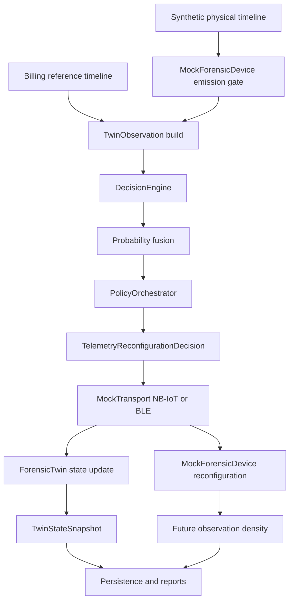
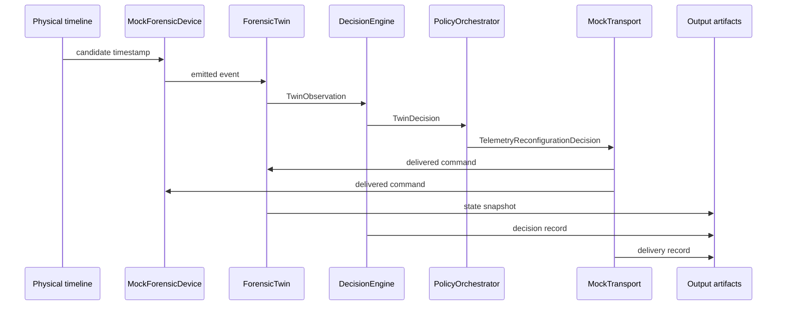
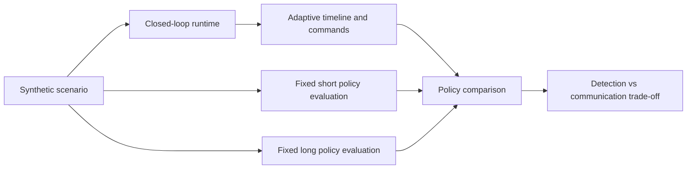

# Flowcharts

## 1. Twin control loop

## 2. Event-level sequence

## 3. Comparison experiment flow

## Recommended use in the article

- Figure 1: use the first flowchart as the framework architecture.
- Figure 2: use the sequence diagram to show the twin control loop.
- Figure 3: use the third flowchart to present the experimental methodology.
